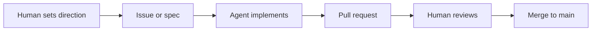

# Harle Development Strategy — Repo Practices & Onboarding

> This document is the entry point for how Harle is developed: git workflow, planning, human-supervised agent workflow, and tooling. It is written for new team members (human or AI) and as a persistent reference for Cursor and other agents.

---

## 1. Purpose and audience

**Who this is for:** New contributors (human or AI) joining the Harle project, and any agent (e.g. Cursor Agent) working in the repository. Use it to understand how work is planned, where documentation lives, and how humans and agents collaborate.

**Relationship to other docs:**

| Doc | Role |
|-----|------|
| [Architecture overview](architecture/overview.md) | System components, data-external principle, technology stack |
| [Project description](project.md) | Purpose, requirements, agent roles |
| [Current goal](current_goal.md) | Current priorities and use-cases |
| [Testing strategy](testing_strategy.md) | Unit, integration, CI, and AI-assisted testing |
| [Main challenges](main_challenges.md) | Known gaps and roadmap |

---

## 2. Repo maintenance model: AI agents with human supervision

**Principle:** The repository is maintained primarily by AI agents (e.g. Cursor Agent), with humans setting direction, reviewing changes, and approving merges.

**Responsibilities:**

| Role | Responsibilities |
|------|------------------|
| **Humans** | Define goals and priorities ([current_goal.md](current_goal.md)); triage issues; review and merge PRs; approve sensitive or high-impact changes; update strategy and architecture docs when making big decisions. |
| **Agents** | Implement features and fixes from issues and specs; follow project rules (`.cursor/rules/`); run tests and linters; propose PRs with focused scope. Agents do **not** merge to `main` or bypass human review. |

---

## 3. Git repository maintenance

### Branching

- **`main`:** Protected; always deployable. Changes only via merged PRs.
- **Feature/fix branches:** Short-lived, named by purpose (e.g. `feat/secretary-trello`, `fix/search-ranking`). No long-lived dev branch unless explicitly documented.

### Workflow

- All work happens on branches. Agents and humans open PRs into `main`; a human (or agreed process) reviews and merges. No direct pushes to `main` from automation or agents.

### Commits

- Prefer clear, atomic commit messages. Agents should describe what changed and why briefly.

### Issues

- Used for planning and task tracking. Best practices:
  - One issue per coherent unit of work.
  - Title and description give enough context for an agent to implement (link to `docs/` when relevant, e.g. architecture, current goal).
  - Optionally use labels for area (orchestrator, cli, docs) and type (bug, feature, refactor).

### Pull requests

- Description should summarize the change and reference issue(s). Agents should list main files changed and any follow-ups. Human review checks correctness, architecture fit, and adherence to project rules.

---

## 4. Planning and prioritization

### Where plans live

- **TRD and high-level plans:** [docs/trd/](.) — [project.md](project.md), [current_goal.md](current_goal.md), [main_challenges.md](main_challenges.md), and architecture docs.
- **Investigations:** [docs/investigations/](../investigations/) — dated or topic-named notes on bugs and odd behaviour.
- **Research:** [docs/research/](../research/) — pre-TRD discovery, options, and references.

### Feature workflow (doc-first)

| Phase | Where | Purpose |
|-------|--------|---------|
| **Complex features** | `docs/trd/` | Create a TRD (technical requirement/design doc) **before** implementation. The TRD defines scope, behaviour, and constraints so agents and humans share context. |
| **Weird or unexpected behaviour** | `docs/investigations/` | When a human spots odd behaviour (bugs, edge cases, surprising results), document it here. Use investigations to track root cause, repro steps, and follow-up; link from issues or PRs when relevant. |
| **Pre-TRD discovery** | `docs/research/` | Use for exploring options, comparing approaches, or gathering references **before** committing to a design in a TRD. Research feeds into TRDs; it does not replace them for complex features. |

### How work is chosen

- Goals and priorities come from [current_goal.md](current_goal.md) and human decisions, broken down into issues/tasks that agents or humans pick up.

### Specs and scope

- For non-trivial work, use a short spec or checklist (in the issue or in `docs/`) so agents and reviewers share context. Agents should not invent large features without a stated goal or spec.

---

## 5. Development rules and quality

### Cursor rules

All agents working in the repo must follow [.cursor/rules/](../../.cursor/rules/). Key rules:

| Rule | Requirement |
|------|-------------|
| **code_quality** | Keep code files under 500 lines. If larger, split into submodules; do not just delete code or comments. |
| **test_coverage** | If the module already has tests, add unit tests for new functionality. Do not add integration tests by default. In PR output, state when tests were skipped per this rule. |
| **docs_frontmatter** | Every new `.md` file in `docs/` must have YAML frontmatter: title, tags, context, last_updated, summary. See [architecture/data.md](architecture/data.md) and `.cursor/rules/docs_frontmatter.mdc`. |

### Testing

- Follow [testing_strategy.md](testing_strategy.md): unit tests for new or affected code where tests already exist; no integration tests unless that strategy doc is updated. When CI is added, it will run on push and PR.

### Codebase layout

- Application code lives in `src/harle/`. Data (vault, database state, runtime config) lives **outside** the repo per architecture. No user data or secrets in the repository.

---

## 6. Human review checklist

Before merging a PR, reviewers (humans) should verify:

- [ ] Behaviour matches the issue or spec.
- [ ] No unintended side effects.
- [ ] Respects the data-external principle and config boundaries (no user data or secrets in repo).
- [ ] Tests added where required by project rules (see test_coverage rule).
- [ ] Docs updated if behaviour or architecture changed.
- [ ] No sensitive data in commits.

---

## 7. References and further reading

| Document | Path |
|----------|------|
| Architecture overview | [docs/trd/architecture/overview.md](architecture/overview.md) |
| Project description | [docs/trd/project.md](project.md) |
| Current goal | [docs/trd/current_goal.md](current_goal.md) |
| Testing strategy | [docs/trd/testing_strategy.md](testing_strategy.md) |
| Main challenges | [docs/trd/main_challenges.md](main_challenges.md) |
| Cursor rules | `.cursor/rules/` (code_quality, test_coverage, docs_frontmatter, and others) |

---

## 8. External tooling and automation — short proposals

The following are **recommendations** for how to use each tool in the human-supervised, agent-maintained workflow. They are not a commitment to adopt all of them; no integration or setup code is implied.

| Tool | Role | Proposal |
|------|------|----------|
| **Cursor** | Primary IDE and agent | Use Agent mode for feature-level changes on branches; keep `.cursor/rules/` as the single source of project conventions; use checkpoints for local rollback and git/PRs as the durable safety net. Optionally document when to use Chat vs Agent (e.g. questions and small edits vs multi-file refactors). |
| **OpenAI Codex / OpenAI API** | Development-time codegen | Harle's runtime already uses OpenAI via a provider wrapper ([architecture/overview.md](architecture/overview.md)). For *development*: Codex or current code-capable OpenAI models can be used for scripted codegen or batch edits (e.g. migrations, boilerplate) via API or Cursor's model settings. Keep all generated code behind human review and tests; do not commit unreviewed API-generated changes to `main`. |
| **Claude (Anthropic)** | Alternative or complement | Use as an alternative in Cursor (model selection in IDE) for long-context docs and refactors, and for review-style tasks (e.g. "review this PR description"). Same guardrails: all changes via branches and PRs, human approval before merge. |
| **Self-hosted models** (vLLM, Ollama, llama.cpp) | Optional local / CI | Architecture already anticipates swapping the provider to an OpenAI-compatible self-hosted endpoint. For *development* tooling: (1) optional local model in Cursor for offline or low-cost edits (e.g. small refactors, docs); (2) future CI jobs that run lint/tests and optionally a review agent behind the firewall; (3) keep self-hosted opt-in so the default path remains simple (hosted Cursor + hosted LLM). Note: Harle runtime's move to self-hosted is a separate deployment decision (see [architecture/overview.md](architecture/overview.md)). |
