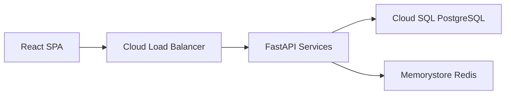

# Harle Import Module Layer — Architecture & Functionality

> The Import Module Layer is how external knowledge enters Harle's awareness. Every time data is brought in from Notion, Miro, Trello, bookmarks, or any future source, the call goes through an import module. Some data is fully materialized into the vault as Markdown files; other data — too large, too dynamic, or too structured to flatten — is stored as lightweight reference files that point back to the source for runtime API access. This layer makes data migration discoverable, configurable, and extensible — whether triggered from the CLI, a scheduled job, or the Orchestrator itself.

This document describes the Import Module Layer's internal architecture: how import sources are structured, how the registry discovers and routes import commands, how the conversion pipeline transforms external data into vault-ready Markdown (or vault reference files), and how the whole layer connects to the Orchestrator, CLI, and the rest of the system.

For the overall system architecture, see [overview.md](./overview.md).
For the vault structure and file conventions, see [data.md](./data.md).
For the tool module architecture (which this design mirrors), see [tools.md](./tools.md).
For the Connections Layer (shared API clients and credentials), see [connections.md](./connections.md).
For the research behind this design, see [vault_ux_onboarding.md](../../research/vault_ux_onboarding.md), Section 2.

---

## Why a Separate Module (Not Part of Tool Modules)

The Tool Module Layer handles **runtime tool calls** — the Orchestrator invokes tools during agent reasoning (search the web, read a Trello card, write a vault note). Import is a different concern:

| Tool Modules | Import Modules |
|---|---|
| Called during agent reasoning (request-time) | Called explicitly by the user or on a schedule |
| Produce ephemeral results for the LLM | Produce persistent vault files |
| Operate on external services (read/write) | Extract from external sources and write to vault |
| Bound by the agentic loop (context, approval) | Run as standalone pipelines with progress reporting |
| Always fast (single API call, seconds) | May be slow (bulk data, vision API, minutes) |

The import layer is analogous to tools in structure (base class, registry, per-source modules) but differs in lifecycle, invocation, and output. Keeping them separate avoids polluting the tool registry with non-agentic operations and allows imports to have their own progress tracking, error recovery, and batch processing logic.

---

## Where the Import Module Layer Sits

```
                        ┌──────────────────────────────────────────────────┐
                        │              ORCHESTRATOR                        │
                        │                                                  │
                        │  ┌──────────┐   ┌──────────┐   ┌─────────────┐  │
                        │  │ HTTP API │   │ CLI      │   │ Scheduler   │  │
                        │  └──────────┘   └────┬─────┘   └──────┬──────┘  │
                        │                      │                │         │
                        │               ┌──────▼────────────────▼──────┐  │
                        │               │      Import Module Layer     │  │
                        │               └──────────────┬───────────────┘  │
                        │                              │                  │
                        └──────────────────────────────┼──────────────────┘
                                                       │
                    ┌──────────────────────────────────┼────────────────────┐
                    │              IMPORT MODULE LAYER                      │
                    │                                                       │
                    │  ┌─────────────────────────────────────────────────┐  │
                    │  │              Import Registry                    │  │
                    │  │                                                 │  │
                    │  │  ┌──────────┐ ┌──────────┐ ┌──────────┐        │  │
                    │  │  │  Notion  │ │   Miro   │ │ Bookmarks│  ...   │  │
                    │  │  │  Source  │ │  Source   │ │  Source  │        │  │
                    │  │  │          │ │          │ │          │        │  │
                    │  │  └────┬─────┘ └────┬─────┘ └────┬─────┘        │  │
                    │  └───────┼────────────┼────────────┼──────────────┘  │
                    │          │            │            │                  │
                    │     ┌────▼────┐  ┌────▼────┐  ┌───▼─────┐          │
                    │     │Converter│  │Converter│  │Converter│          │
                    │     │Pipeline │  │Pipeline │  │Pipeline │          │
                    │     └────┬────┘  └────┬────┘  └────┬────┘          │
                    │          │            │            │                  │
                    │          └────────────┼────────────┘                  │
                    │                       │                               │
                    │                       ▼                               │
                    │               ┌──────────────┐                       │
                    │               │  Vault Writer │                       │
                    │               └──────────────┘                       │
                    └──────────────────────────────────────────────────────┘
```

The Import Module Layer is an internal part of the Orchestrator process. It provides four things:

1. **Import Sources** — self-contained packages for each external system (e.g., all Notion import logic lives in one module).
2. **Import Registry** — a central catalog that discovers, registers, and routes import commands across all sources.
3. **Conversion Pipeline** — a multi-step pipeline that transforms raw external data into vault-ready Markdown (full materialization) or lightweight reference files with metadata and access instructions (reference import).
4. **Vault Writer** — a shared component that writes both fully materialized and reference files to the vault, respecting directory conventions and deduplication.

---

## Not a One-Time Setup

Import is **not** an init-time or one-time operation. Users re-import data as their external systems evolve:

| Scenario | When import runs |
|---|---|
| Initial onboarding | First setup — bulk import from Notion, Miro, bookmarks |
| Weekly sync | User adds new Notion pages and re-imports to capture them |
| Project handoff | New Miro boards for a new project — import the latest boards |
| Tool migration | User moves from Trello to Linear — new source, same pipeline |
| Selective refresh | "Re-import just the architecture boards from Miro" |

The module must support **incremental imports** (detect what is already in the vault and skip or update), **selective scope** (import a single board, a specific workspace, or a date range), and **idempotent re-runs** (importing the same source twice does not create duplicates).

---

## Full Materialization vs. Reference Import

Not all imported data belongs in the vault as full Markdown files. Some data is better represented as a **lightweight reference** — a vault file that describes *what exists* in the external system and *how to access it*, while the actual content is fetched via the source's API at runtime.

### Why two strategies

| Concern | Full Materialization | Reference (Meta-Only) |
|---|---|---|
| **Data volume** | Works well for tens to hundreds of items | Necessary when the source has thousands of rows (e.g., a Notion database with 500+ entries) |
| **Change frequency** | Good for stable content (archived notes, finalized diagrams) | Better for live data that changes daily (task boards, active databases, calendars) |
| **Searchability** | Fully indexed in Whoosh and Indexer — keyword search works | Only the metadata/summary is searchable; full content requires a runtime API call |
| **Offline access** | Available without network | Requires API access to fetch actual content |
| **Vault size** | Grows with every import | Stays small — one file per source entity regardless of its size |
| **Agent context** | Full content can be included in the LLM context directly | Agent sees the summary and knows it can call a tool to fetch details on demand |

### How it works

The source decides per-item which strategy to use. A single import run can produce a mix of fully materialized items and reference items. The decision is driven by the source's nature and the user's configuration:

```
Source extract() produces ImportItems
         │
    ┌────┴────────────┐
    │                 │
    ▼                 ▼
  FULL              REFERENCE
  (content_type      (content_type
   = MARKDOWN/IMAGE)  = REFERENCE)
    │                 │
    ▼                 ▼
  Vault file with   Vault file with
  complete content  metadata + summary
  (searchable,      + access instructions
   offline-ready)   (lightweight, points
                     to source API)
```

**Reference vault files** contain:

1. **Frontmatter** with standard import metadata plus `access_via` (which tool module can fetch the data) and `access_params` (IDs, filters, or queries the tool needs).
2. **Human-readable summary** — what the source entity contains, its schema (for databases), its scope, and when it was last synced.
3. **Agent instructions** — a brief note telling the agent how to access the full data at runtime (e.g., "Use the Notion tool module with database ID `db_xyz` to query this data").

This design keeps the vault as the single catalog of "what Harle knows about" while avoiding the problem of bloating it with data that is better accessed live.

### Reference vault file example (Notion database)

```markdown
---
title: "Project Tracker — Notion Database"
tags: [projects, tracker, notion, imported, reference]
context: work
last_updated: 2026-03-01
summary: "Notion database tracking 47 active projects with status, owner, and deadline fields."
import_source: notion
import_source_id: "db_abc123"
import_date: 2026-03-01
import_type: reference
access_via: notion
access_params:
  database_id: "db_abc123"
  default_filter: { "property": "Status", "status": { "does_not_equal": "Archived" } }
sync_summary:
  row_count: 47
  last_synced: 2026-03-01T14:00:00Z
  schema:
    - { name: "Project Name", type: "title" }
    - { name: "Status", type: "select", options: ["Active", "On Hold", "Archived"] }
    - { name: "Owner", type: "person" }
    - { name: "Deadline", type: "date" }
    - { name: "Priority", type: "select", options: ["P0", "P1", "P2", "P3"] }
---

# Project Tracker — Notion Database

> Reference import from Notion database "Project Tracker" (47 rows).
> Full data is accessed via the Notion tool module at runtime.

## What This Contains

A project tracking database with 47 active entries. Each row represents
a project with its current status, assigned owner, deadline, and priority.

## Schema

| Column | Type | Values |
|---|---|---|
| Project Name | title | — |
| Status | select | Active, On Hold, Archived |
| Owner | person | — |
| Deadline | date | — |
| Priority | select | P0, P1, P2, P3 |

## How to Access

To query this database, use the Notion tool:
- `search_database(database_id="db_abc123")` — all active rows
- `search_database(database_id="db_abc123", filter={"Priority": "P0"})` — P0 projects only

## Sample Rows (at last sync)

| Project Name | Status | Priority | Deadline |
|---|---|---|---|
| Platform Migration | Active | P0 | 2026-04-15 |
| Mobile App Redesign | Active | P1 | 2026-05-01 |
| API Documentation | On Hold | P2 | — |
```

### Connection to Tool Modules

Reference imports create a deliberate bridge between the Import Module Layer and the Tool Module Layer:

```
Import Module                     Vault                      Tool Module
(runs periodically)              (persistent)                (runs at request-time)
      │                               │                           │
      │  extract metadata ──────>  reference file  <──── agent reads summary
      │  + schema + summary        (lightweight)          and access_params
      │                               │                           │
      │                               │                    agent calls tool:
      │                               │                    notion.search_database(
      │                               │                      database_id="db_abc123"
      │                               │                    )
      │                               │                           │
      │                               │                    tool returns live data
      │                               │                    → agent uses in response
```

- **The import module** creates and periodically refreshes the reference file — updating row counts, schema changes, and the sample rows.
- **The vault file** acts as a catalog entry that the Search Algorithm can find and include in context, telling the agent "this data exists and here is how to get it."
- **The tool module** provides the runtime API access. The `access_via` field in frontmatter names the tool module; `access_params` provides the parameters.

This separation means:
- The agent does not need to know about every Notion database up front — it discovers them through vault search, just like any other knowledge.
- The user sees all their imported sources in the vault (browsable in Obsidian or any editor) without the vault growing to thousands of files.
- Re-import updates only the metadata (row count, schema, sample rows) without re-materializing all content.

### When to use which strategy

The source's `extract()` method decides per-item. Guidelines for source implementors:

| Use full materialization when... | Use reference when... |
|---|---|
| Content is stable (archived notes, finalized docs) | Content changes frequently (active databases, calendars) |
| Item count is small (tens of items) | Item count is large (hundreds or thousands of rows) |
| Content is primarily text/Markdown | Content is primarily structured/tabular data |
| Offline access is important | Runtime API access is acceptable |
| Content should be keyword-searchable in full | Summary + schema search is sufficient |
| Source has no corresponding tool module | A tool module exists for runtime access |

A source can default to one strategy and let the user override via config (e.g., `notion.databases.strategy: reference` vs. `notion.databases.strategy: full`).

---

## Internal Components

The Import Module Layer consists of four components. Each has one job.

### 1. BaseImportSource (the contract every source implements)

**What it does:** Defines the interface that every import source must follow. Any external system you add to Harle — whether it reads from a ZIP export, an API, or a local directory — implements this interface.

**Key design principle:** Each source knows how to extract data from its system and convert it into a list of `ImportItem` objects — intermediate representations that the pipeline then writes to the vault. The source does not write files directly; it produces structured items that the shared Vault Writer handles.

```python
from abc import ABC, abstractmethod
from dataclasses import dataclass, field
from enum import Enum
from pathlib import Path


class ContentType(Enum):
    """Type of content an import item carries."""
    MARKDOWN = "markdown"
    IMAGE = "image"
    STRUCTURED = "structured"
    REFERENCE = "reference"


@dataclass
class AccessInfo:
    """How to access the source data at runtime via a tool module.

    Stored in the vault file's frontmatter so agents know which
    tool to call and with what parameters.
    """
    tool_module: str
    params: dict
    default_filter: dict | None = None


@dataclass
class ImportItem:
    """Intermediate representation of a single importable unit.

    Produced by a source's extract+convert step. Consumed by the
    Vault Writer to create or update vault files.

    Items with content_type=REFERENCE produce lightweight vault
    files containing metadata, a summary, and access instructions
    instead of the full source content. See the "Full
    Materialization vs. Reference Import" section.
    """
    source_id: str
    title: str
    content: str
    content_type: ContentType
    suggested_path: str
    tags: list[str] = field(default_factory=list)
    context: str = "personal"
    metadata: dict = field(default_factory=dict)
    images: list[Path] = field(default_factory=list)
    access_info: AccessInfo | None = None


@dataclass
class ImportResult:
    """Summary of an import run for a single source."""
    source_name: str
    items_found: int
    items_imported: int
    items_skipped: int
    items_failed: int
    errors: list[str] = field(default_factory=list)
    created_paths: list[str] = field(default_factory=list)
    updated_paths: list[str] = field(default_factory=list)


class BaseImportSource(ABC):

    @property
    @abstractmethod
    def name(self) -> str:
        """Unique source identifier (e.g. 'notion', 'miro')."""
        ...

    @property
    @abstractmethod
    def description(self) -> str:
        """Human-readable description for CLI help and logging."""
        ...

    async def initialize(
        self,
        config: dict,
        connections: "ConnectionRegistry | None" = None,
    ) -> None:
        """Set up the source with config and optional connections.

        Sources that support API mode should look up their
        connection from the connections registry (see
        connections.md). Sources that only support file mode
        can ignore the connections parameter.

        Called once at registration time. The connection is
        stored and reused across multiple extract() calls.
        """
        pass

    @abstractmethod
    def supported_modes(self) -> list[str]:
        """Return the import modes this source supports.

        Common modes: 'file' (from an export file/directory),
        'api' (from a live API connection).
        """
        ...

    @abstractmethod
    async def validate_input(self, config: dict) -> list[str]:
        """Check whether the provided config is valid for import.

        Returns a list of validation errors (empty = valid).
        Checks file existence, connection availability, required
        fields, etc.
        """
        ...

    @abstractmethod
    async def extract(self, config: dict) -> list[ImportItem]:
        """Extract data from the source and return ImportItems.

        This is the core method. It reads from the external system
        (file, API, directory) and produces a list of ImportItems
        ready for the Vault Writer.

        For API-mode sources, the authenticated HTTP client is
        available via the connection stored during initialize().

        For sources with image content, items should have
        content_type=IMAGE and the raw image path in `images`.
        The pipeline will run vision/OCR conversion before writing.
        """
        ...

    async def preview(self, config: dict) -> list[ImportItem]:
        """Return items without writing — for user review.

        Default implementation calls extract(). Sources may override
        to provide a lighter preview (e.g. titles only, no content).
        """
        return await self.extract(config)

    def default_config(self) -> dict:
        """Return default configuration values for this source.

        Merged with user-provided config (user values take precedence).
        """
        return {}
```

**Where information lives (no duplication):**

| What | Where it lives | Who reads it |
|---|---|---|
| Source identity | `BaseImportSource.name` | Registry, CLI, logging |
| Source description | `BaseImportSource.description` | CLI help text |
| Supported modes | `BaseImportSource.supported_modes()` | CLI validation, config |
| Input validation | `BaseImportSource.validate_input()` | CLI before import, Registry |
| Extraction logic | `BaseImportSource.extract()` | Import pipeline |
| API connection | `connection: <name>` in config → looked up from Connection Registry at `initialize()` | Source receives authenticated client via `connections.get(<name>).get_client()` (see [connections.md](./connections.md)) |
| Default config | `BaseImportSource.default_config()` | Registry merges with user config |
| User config | `config.yaml` → `import_sources.<source>` | Registry reads at startup |

---

### 2. Import Registry (discover, register, route)

**What it does:** The Import Registry is the central catalog of all available import sources. It discovers source modules, validates their configuration, and provides the bridge between the CLI/Orchestrator and the import pipeline.

```python
class ImportRegistry:

    def register_source(self, source: BaseImportSource) -> None:
        """Register a source and index it by name."""
        self._sources[source.name] = source

    def get_source(self, name: str) -> BaseImportSource:
        """Return a registered source by name."""
        if name not in self._sources:
            raise ImportSourceNotFound(
                f"Import source '{name}' is not registered. "
                f"Available: {', '.join(self.list_sources())}"
            )
        return self._sources[name]

    def list_sources(self) -> list[str]:
        """Return names of all registered sources."""
        return list(self._sources.keys())

    async def run_import(
        self,
        source_name: str,
        config: dict,
        dry_run: bool = False,
    ) -> ImportResult:
        """Execute the full import pipeline for a source.

        Steps:
        1. Look up the source in the registry
        2. Merge default config with user config
        3. Validate input
        4. Extract items from the source
        5. Run conversion pipeline (image reading, frontmatter)
        6. If dry_run: return preview without writing
        7. Write items to vault via Vault Writer
        8. Return ImportResult summary
        """
        ...
```

**Why a registry (not direct source instantiation):**

- **Discoverability.** The CLI can list all available sources: `harle import --list`.
- **Uniform invocation.** `harle import notion ...` and `harle import miro ...` go through the same code path — config validation, extraction, conversion, writing.
- **Lifecycle management.** Sources are initialized once with their connection (from the shared Connections Layer) and reused across multiple import runs in the same session.
- **Extensibility.** Adding a new source means registering one more class — nothing else changes.

---

### 3. Conversion Pipeline (extract → transform → write)

**What it does:** The Conversion Pipeline transforms raw `ImportItem` objects from sources into vault-ready Markdown files. It handles frontmatter generation, image reading (via vision API or OCR), content normalization, and directory placement.

```
ImportItem (from source)
         │
    Step 0: STRATEGY CHECK
         │  If content_type == REFERENCE:
         │    → Skip Steps 1–2 (no content to normalize or images to process)
         │    → Jump to Step 3 with reference-specific frontmatter
         │
    Step 1: CONTENT NORMALIZATION
         │  Clean up HTML artifacts, fix internal links,
         │  normalize heading levels, strip source-specific markup
         │
    Step 2: IMAGE PROCESSING (conditional)
         │  If content_type == IMAGE or item has images:
         │    → Send to vision API (e.g. GPT-4o vision)
         │    → Convert to text description, Mermaid diagram,
         │      or structured Markdown
         │    → Replace image reference with generated content
         │
    Step 3: FRONTMATTER GENERATION
         │  Generate YAML frontmatter:
         │    title: from item.title or inferred from content
         │    tags: from item.tags + auto-detected from content
         │    context: from item.context or inferred from path
         │    last_updated: current date
         │    summary: auto-generated from content
         │    import_source: source name
         │    import_source_id: original ID in source system
         │
         │  For REFERENCE items, additionally:
         │    import_type: reference
         │    access_via: tool module name (from access_info)
         │    access_params: parameters for the tool (from access_info)
         │    sync_summary: row counts, schema, last sync time
         │
    Step 4: PATH RESOLUTION
         │  Determine vault path:
         │    → Use item.suggested_path if provided
         │    → Otherwise infer from context + content analysis
         │    → Resolve conflicts (file already exists)
         │
    Step 5: DEDUPLICATION CHECK
         │  Check if a file with the same import_source_id exists:
         │    → If yes and content changed: update (preserve user edits
         │      to frontmatter where possible)
         │    → If yes and content unchanged: skip
         │    → If no: create new file
         │
         ▼
    Vault-ready Markdown file
    (full content OR reference with metadata + access instructions)
```

**Import-specific frontmatter fields:**

Beyond the standard vault frontmatter (`title`, `tags`, `context`, `last_updated`, `summary`), imported files include additional fields depending on the import type.

**Fully materialized items:**

```yaml
---
title: "Q1 Platform Architecture"
tags: [architecture, platform, imported, miro]
context: work
last_updated: 2026-03-01
summary: "Architecture diagram for the Q1 platform migration project."
import_source: miro
import_source_id: "board_abc123"
import_date: 2026-03-01
---
```

**Reference items** (meta-only — actual data accessed via tool module at runtime):

```yaml
---
title: "Project Tracker — Notion Database"
tags: [projects, tracker, notion, imported, reference]
context: work
last_updated: 2026-03-01
summary: "Notion database tracking 47 active projects with status, owner, and deadline."
import_source: notion
import_source_id: "db_abc123"
import_date: 2026-03-01
import_type: reference
access_via: notion
access_params:
  database_id: "db_abc123"
  default_filter: { "property": "Status", "status": { "does_not_equal": "Archived" } }
sync_summary:
  row_count: 47
  last_synced: 2026-03-01T14:00:00Z
---
```

The shared `import_source` and `import_source_id` fields enable:
- **Deduplication.** Re-importing the same board does not create a second file.
- **Update tracking.** The pipeline can detect whether the source content changed since the last import.
- **Provenance.** The user knows where each file came from.

The reference-specific fields enable:
- **Runtime access.** `access_via` names the tool module; `access_params` provides the parameters the agent needs to fetch live data.
- **Catalog completeness.** The vault contains an entry for every known data source, even those too large or dynamic to materialize.
- **Sync awareness.** `sync_summary` tells the agent (and the user) how fresh the metadata is and what to expect from the source.

**Image processing details:**

A significant share of importable knowledge lives in images (diagrams, whiteboards, screenshots). The pipeline handles this via a configurable image processor:

```python
class ImageProcessor:

    async def process(
        self,
        image_path: Path,
        context_hint: str = "",
    ) -> str:
        """Convert an image to Markdown text.

        Uses a vision-capable LLM to describe the image content.
        The context_hint (e.g. "architecture diagram from Miro")
        helps the model produce more relevant output.

        Returns Markdown text: a description, a Mermaid diagram,
        bullet-point summary, or a combination — depending on
        the image content.
        """
        ...
```

Image processing is:
- **Optional.** Sources without images skip this step entirely.
- **Configurable.** The model and detail level are set in config (`import.image_processor.model`, `import.image_processor.detail`).
- **Cost-aware.** Each image costs ~$0.01–0.05 to process. The pipeline reports estimated cost before running and supports a `--max-cost` flag.

---

### 4. Vault Writer (shared write logic)

**What it does:** The Vault Writer takes converted Markdown content and writes it to the vault, handling directory creation, conflict resolution, and post-write indexing.

```python
class VaultWriter:

    async def write_items(
        self,
        items: list[ConvertedItem],
        vault_path: Path,
        strategy: str = "skip_existing",
    ) -> WriteResult:
        """Write converted items to the vault.

        Args:
            items: Converted Markdown items ready for writing.
            vault_path: Root path of the vault.
            strategy: How to handle existing files:
                - 'skip_existing': do not overwrite (default)
                - 'update_changed': overwrite if source content changed
                - 'force': always overwrite

        Returns:
            WriteResult with counts of created, updated, skipped files.
        """
        ...
```

The Vault Writer is shared across all sources — each source produces `ImportItem` objects, the pipeline converts them, and the writer handles the filesystem. This avoids duplicating file-writing logic in every source.

After writing, the Vault Writer optionally triggers a re-index of the affected files (via the Indexer's sync mechanism) so that newly imported content is immediately searchable.

---

## Import Source Structure

Every import source follows the same directory layout, mirroring the convention from the Tool Module Layer. Sources that access external APIs no longer include their own `api_client.py` — API credentials, authenticated HTTP clients, and rate limiting live in the shared Connections Layer (see [connections.md](./connections.md)). Sources receive an authenticated client at `initialize()` via `connections.get("<name>").get_client()`.

```
src/harle/vault_imports/
├── __init__.py
├── base.py                    # BaseImportSource ABC, ImportItem, ImportResult
├── registry.py                # ImportRegistry class
├── pipeline.py                # Conversion pipeline (normalize, image, frontmatter)
├── writer.py                  # Vault Writer (shared file-write logic)
├── image_processor.py         # Vision API / OCR image-to-text converter
│
├── notion/
│   ├── __init__.py
│   ├── source.py              # NotionImportSource(BaseImportSource) — uses connections.get("notion") for API mode
│   └── parser.py              # Notion export parser (ZIP → structured data, file mode only)
│
├── miro/
│   ├── __init__.py
│   └── source.py              # MiroImportSource(BaseImportSource) — uses connections.get("miro")
│
├── bookmarks/                 # (future — no connection, parses local HTML)
│   └── ...
│
├── trello/                    # (future — uses connections.get("trello"))
│   └── ...
│
└── obsidian/                  # (future — no connection, reads local directory)
    └── ...
```

API clients that were previously in per-source `api_client.py` files are now centralized in `src/harle/connections/` (one file per external service). See [connections.md](./connections.md) for the full Connections Layer architecture.

---

## Example Sources

Two sources are detailed below to illustrate the pattern. Other sources (Trello, bookmarks, Obsidian, Google Keep, email, calendar) follow the same structure and are added by implementing `BaseImportSource` and registering with the registry.

### Example 1: Notion

Notion is the most common source for Harle users. It contains structured project notes, wikis, and databases — the closest external equivalent to the vault.

**Supported modes:**

| Mode | Input | What it does |
|---|---|---|
| `file` | Notion export ZIP (`--zip <path>`) | Parses the ZIP containing Markdown + CSV files from Notion's native export. No connection needed. |
| `api` | Shared `notion` connection (configured in `config.yaml`) | Queries the Notion API to fetch pages and databases directly using the authenticated client from the Connections Layer. |

**`src/harle/vault_imports/notion/source.py` (example):**

```python
from harle.connections.registry import ConnectionRegistry
from harle.vault_imports.base import (
    BaseImportSource,
    ContentType,
    ImportItem,
)
from harle.vault_imports.notion.parser import NotionExportParser


class NotionImportSource(BaseImportSource):
    name = "notion"
    description = "Import pages and databases from Notion"

    async def initialize(
        self, config: dict, connections: ConnectionRegistry | None = None
    ) -> None:
        self._config = config
        if connections and connections.has("notion"):
            self._conn = connections.get("notion")
        else:
            self._conn = None

    def supported_modes(self) -> list[str]:
        return ["file", "api"]

    async def validate_input(self, config: dict) -> list[str]:
        errors = []
        mode = config.get("mode", "file")

        if mode == "file":
            zip_path = config.get("zip_path")
            if not zip_path:
                errors.append("--zip is required for file mode")
            elif not Path(zip_path).exists():
                errors.append(f"File not found: {zip_path}")
        elif mode == "api":
            if self._conn is None:
                errors.append(
                    "API mode requires the 'notion' connection. "
                    "Add it to the connections section in config.yaml."
                )

        return errors

    async def extract(self, config: dict) -> list[ImportItem]:
        mode = config.get("mode", "file")

        if mode == "file":
            return await self._extract_from_zip(config)
        return await self._extract_from_api(config)

    async def _extract_from_zip(
        self, config: dict
    ) -> list[ImportItem]:
        parser = NotionExportParser(config["zip_path"])
        raw_pages = parser.parse()

        items = []
        for page in raw_pages:
            item = ImportItem(
                source_id=page.id,
                title=page.title,
                content=page.markdown_content,
                content_type=ContentType.MARKDOWN,
                suggested_path=self._suggest_path(page),
                tags=self._extract_tags(page),
                context=config.get("context", "personal"),
                metadata={
                    "notion_id": page.id,
                    "notion_parent": page.parent_id,
                    "notion_properties": page.properties,
                },
                images=page.embedded_images,
            )
            items.append(item)

        return items

    async def _extract_from_api(
        self, config: dict
    ) -> list[ImportItem]:
        client = self._conn.get_client()
        # Uses the shared authenticated Notion client
        # from the Connections Layer — same client as
        # the Notion tool module
        ...

    def default_config(self) -> dict:
        return {
            "mode": "file",
            "context": "personal",
            "target_dir": "knowledge/",
        }
```

The source no longer creates its own `NotionApiClient`. For API mode, it uses the shared `NotionConnection` from the Connections Layer — the same connection used by the Notion tool module. For file mode, no connection is needed (the source parses a local ZIP). This keeps file-based imports working without any connection configuration.

**Notion-specific conversion challenges:**

| Challenge | How the source handles it |
|---|---|
| Notion's internal links (`/page-id`) | Replaced with vault-relative links or removed with a `[source: Notion]` note |
| Database exports (CSV alongside Markdown) | **Small databases** (< configurable threshold, default 50 rows): CSV rows are converted to individual `.md` files with properties as frontmatter (compatible with Obsidian's Dataview plugin). **Large databases**: imported as a single reference file with schema, row count, sample rows, and `access_via: notion` for runtime queries. See "Full Materialization vs. Reference Import" section. |
| Nested page hierarchy | Preserved as directory structure under the target path |
| Embedded images | Extracted from the ZIP, passed as `images` on the ImportItem for vision processing |
| Property types (select, multi-select, date, relation) | Mapped to frontmatter fields with appropriate YAML types |

**Materialization strategy for Notion (per content type):**

| Notion content type | Default strategy | Rationale |
|---|---|---|
| Pages (wiki, notes) | Full materialization | Stable text content, high search value, works offline |
| Small databases (< 50 rows) | Full materialization | Manageable size, useful to have individual entries searchable |
| Large databases (50+ rows) | Reference | Too many files; better to store schema + sample and query live via Notion tool |
| Databases with relations/rollups | Reference | Relational queries lose meaning when flattened to individual files |

The threshold (default: 50 rows) is configurable via `notion.database_materialization_threshold` in `config.yaml`. Users can also force a strategy per database with `--strategy reference` or `--strategy full`.

**CLI usage:**

```bash
# File-based import (from Notion export ZIP — no connection needed)
harle import notion --zip ~/Downloads/notion-export.zip --context work

# API-based import (uses the shared 'notion' connection from config.yaml)
harle import notion --mode api --workspace "Acme Corp"

# Preview what would be imported (dry run)
harle import notion --zip ~/Downloads/notion-export.zip --dry-run

# Import only pages matching a filter
harle import notion --zip ~/Downloads/notion-export.zip --filter "projects/*"
```

---

### Example 2: Miro

Miro is a visual collaboration tool. Its content is primarily **image-based** — boards contain diagrams, process maps, architecture drawings, sticky notes, and freeform sketches. Importing Miro requires the image processing pipeline.

**Supported modes:**

| Mode | Input | What it does |
|---|---|---|
| `api` | Shared `miro` connection (configured in `config.yaml`) + board ID(s) | Fetches board content via the authenticated Miro API client from the Connections Layer — retrieves both structured data (frames, sticky notes, text objects) and board images |

Miro does not offer a useful offline export format for automation (PDF/PNG exports lose structure). The API mode is the primary path.

**`src/harle/vault_imports/miro/source.py` (example):**

```python
from harle.connections.registry import ConnectionRegistry
from harle.vault_imports.base import (
    BaseImportSource,
    ContentType,
    ImportItem,
)


class MiroImportSource(BaseImportSource):
    name = "miro"
    description = "Import boards and diagrams from Miro"

    async def initialize(
        self, config: dict, connections: ConnectionRegistry | None = None
    ) -> None:
        self._config = config
        self._conn = connections.get("miro")
        self._client = self._conn.get_client()

    def supported_modes(self) -> list[str]:
        return ["api"]

    async def validate_input(self, config: dict) -> list[str]:
        errors = []
        if self._conn is None:
            errors.append(
                "Miro import requires the 'miro' connection. "
                "Add it to the connections section in config.yaml."
            )
        if not config.get("board_ids") and not config.get("team_id"):
            errors.append(
                "Provide --board <id> or --team <id> to "
                "select boards"
            )
        return errors

    async def extract(self, config: dict) -> list[ImportItem]:
        board_ids = config.get("board_ids", [])

        if config.get("team_id"):
            board_ids = await self._list_team_boards(
                config["team_id"]
            )

        items = []
        for board_id in board_ids:
            board = await self._get_board(board_id)
            board_image = await self._export_board_image(
                board_id
            )

            structured_text = self._extract_structured_content(
                board
            )

            item = ImportItem(
                source_id=board_id,
                title=board.name,
                content=structured_text,
                content_type=ContentType.IMAGE,
                suggested_path=self._suggest_path(board, config),
                tags=self._extract_tags(board),
                context=config.get("context", "work"),
                metadata={
                    "miro_board_id": board_id,
                    "miro_board_url": board.view_link,
                    "miro_last_modified": board.modified_at,
                    "miro_item_count": len(board.items),
                },
                images=[board_image],
            )
            items.append(item)

            for frame in board.frames:
                frame_image = await self._export_frame_image(
                    board_id, frame.id
                )
                frame_item = ImportItem(
                    source_id=f"{board_id}/frame/{frame.id}",
                    title=f"{board.name} — {frame.title}",
                    content=self._extract_frame_text(frame),
                    content_type=ContentType.IMAGE,
                    suggested_path=self._suggest_path(
                        board, config, frame=frame
                    ),
                    tags=self._extract_tags(board, frame),
                    context=config.get("context", "work"),
                    metadata={
                        "miro_board_id": board_id,
                        "miro_frame_id": frame.id,
                    },
                    images=[frame_image],
                )
                items.append(frame_item)

        return items

    def _extract_structured_content(self, board) -> str:
        """Extract text from structured Miro objects.

        Sticky notes, text blocks, shapes with labels, and
        connectors are converted to Markdown. This structured
        text is combined with the vision-generated description
        of the board image during the conversion pipeline.
        """
        ...

    def default_config(self) -> dict:
        return {
            "context": "work",
            "target_dir": "knowledge/work/",
            "include_frames": True,
            "image_detail": "high",
        }
```

**Miro-specific conversion challenges:**

| Challenge | How the source handles it |
|---|---|
| Visual content (diagrams, flows) | Board and frame images are exported via the shared Miro connection's API client, then sent through the image processor (vision API) to generate Markdown descriptions or Mermaid diagrams |
| Structured objects (sticky notes, text, shapes) | Extracted via the Miro connection's API client and converted to bullet lists or tables |
| Large boards with many frames | Each frame becomes a separate ImportItem — one vault file per frame, with a parent file linking them |
| Board-level context (who created it, when) | Stored in `metadata` and written to frontmatter |
| Connectors and relationships between objects | Converted to a textual description (e.g., "Component A → connects to → Component B") appended to the structured content |
| Frequently updated boards | Can be imported as **reference** items — the vault file stores a vision-generated summary and board metadata, while the Miro tool module provides runtime access to the latest board state. Useful for living whiteboards that change daily. |

**Materialization strategy for Miro:**

| Scenario | Default strategy | Rationale |
|---|---|---|
| Finalized architecture diagrams | Full materialization | Stable content, high search value, expensive to re-process |
| Active brainstorming boards | Reference | Changes frequently, summary + link is sufficient |
| Boards with many frames | Full per-frame | Each frame is a self-contained unit worth materializing |

The user controls this via `--strategy reference` or `--strategy full` per board. By default, Miro uses full materialization (the vision processing cost is already paid during extract, so materializing the result costs nothing extra).

**CLI usage:**

```bash
# Import a specific board (uses the shared 'miro' connection from config.yaml)
harle import miro --board <board-id>

# Import all boards from a team
harle import miro --team <team-id> --context work

# Preview with cost estimate (vision API calls)
harle import miro --board <board-id> --dry-run

# Re-import (update changed boards, skip unchanged)
harle import miro --board <board-id> --strategy update_changed
```

**Output example (generated vault file):**

```markdown
---
title: "Q1 Platform Architecture"
tags: [architecture, platform, miro, imported, diagram]
context: work
last_updated: 2026-03-01
summary: "Architecture diagram showing the Q1 platform migration from AWS to GCP."
import_source: miro
import_source_id: "board_abc123"
import_date: 2026-03-01
---

# Q1 Platform Architecture

> Imported from Miro board "Q1 Platform Architecture" on 2026-03-01.
> [View original board](https://miro.com/app/board/abc123/)

## Architecture Overview

The board shows a three-tier architecture migrating from AWS to GCP:

- **Frontend:** React SPA deployed on Cloud Run
- **API Layer:** FastAPI services behind Cloud Load Balancer
- **Data Layer:** PostgreSQL on Cloud SQL + Redis on Memorystore

## Data Flow



## Sticky Notes

- "Need to decide on Cloud Run vs GKE by March 15"
- "Redis cache invalidation strategy TBD"
- "Migration window: April 1–15"
```

---

## How It Works End-to-End

### Import Invocation

```
1. User runs: harle import miro --board <id>
   (API credentials come from the shared 'miro' connection in config.yaml)
2. CLI parses the command and builds a config dict:
   {source: "miro", board_ids: ["<id>"]}
3. CLI calls the Orchestrator's import endpoint (or runs the
   pipeline directly in the CLI process — see Technology Choices)
```

### Import Pipeline Execution

```
4. Import Registry looks up the "miro" source
5. Merge source.default_config() with user config
6. Call source.validate_input(config)
   → If errors: report and stop
7. Call source.extract(config)
   → Returns list of ImportItems
   → Progress: "Fetching board abc123... 12 items found"

8. Conversion Pipeline processes each ImportItem:
   a. Normalize content (clean HTML, fix links)
   b. If content_type == IMAGE:
      → Call ImageProcessor.process(image, context_hint)
      → Merge vision output with structured text
   c. Generate frontmatter (title, tags, context, import metadata)
   d. Resolve vault path
   e. Check for duplicates (by import_source + import_source_id)

9. If --dry-run:
   → Display preview: titles, paths, estimated cost
   → Stop without writing

10. Vault Writer writes files:
    → Create directories as needed
    → Write Markdown files with frontmatter
    → Report: "Created 8 files, updated 2, skipped 2"

11. Trigger re-index of affected files
    → Indexer picks up new files on next sync (or immediate)

12. Return ImportResult to CLI
    → CLI displays summary
```

---

## Configuration

Import source configuration lives in the Orchestrator's `config.yaml` under the `import_sources` key. Each source has its own section. Sources that access external APIs reference a named connection from the `connections` section (see [connections.md](./connections.md)) — credentials and API client setup live there, not in the import source config.

```yaml
# Connections are configured once, shared across tool modules and import sources.
# See connections.md for the full connections section.
connections:
  notion:
    enabled: true
    api_token: ${NOTION_API_TOKEN}
  miro:
    enabled: true
    api_token: ${MIRO_API_TOKEN}
  trello:
    enabled: false
    api_key: ${TRELLO_API_KEY}
    api_token: ${TRELLO_API_TOKEN}

# Import sources reference connections by name — no credentials here
import_sources:
  notion:
    enabled: true
    connection: notion            # ← references connections.notion (shared with Notion tool module)
    default_mode: file
    default_context: personal
    target_dir: "knowledge/"

  miro:
    enabled: true
    connection: miro              # ← references connections.miro
    default_context: work
    target_dir: "knowledge/work/"
    include_frames: true
    image_detail: high            # high | low — vision API detail level

  bookmarks:
    enabled: true
    # No connection — bookmarks are parsed from a local HTML file
    default_context: personal
    target_dir: "knowledge/personal/bookmarks/"

  trello:
    enabled: false
    connection: trello            # ← references connections.trello (shared with Trello tool module)

# Image processing settings (shared across all sources)
import:
  image_processor:
    enabled: true
    model: "gpt-4o"               # Vision-capable model
    detail: "high"                # high | low
    max_cost_per_run: 1.00        # USD — abort if estimated cost exceeds this
  write_strategy: "skip_existing" # skip_existing | update_changed | force
  vault_path: ${HARLE_VAULT_PATH}
```

**Configuration sources (priority order):**

| Priority | Source | Example |
|---|---|---|
| **1 (highest)** | CLI flags | `--context work --strategy update_changed` |
| **2** | Environment variables | `MIRO_API_TOKEN=abc123` (for connection credentials) |
| **3** | `config.yaml` values | `connection: miro`, `default_context: work` |
| **4 (lowest)** | Source defaults (in code) | `context: "personal"` |

---

## CLI Integration

The import module extends the Harle CLI with the `import` command group:

```
harle import <source> [flags]

Available sources:
  notion       Import pages and databases from Notion
  miro         Import boards and diagrams from Miro
  bookmarks    Import browser bookmarks (HTML export)
  trello       Import boards and cards from Trello
  obsidian     Import from an Obsidian vault

Global flags:
  --dry-run              Preview what would be imported without writing
  --context <scope>      Set context for imported files (work/personal)
  --target-dir <path>    Override target directory in vault
  --strategy <mode>      Write strategy: skip_existing, update_changed, force
  --filter <pattern>     Only import items matching the pattern
  --max-cost <usd>       Abort if estimated vision API cost exceeds this
  --list                 List available import sources and their status
```

The `import` command is implemented in the Go CLI. It builds a config dict from flags and sends it to the Orchestrator's `/import` endpoint, then streams progress updates back to the terminal.

Alternatively, for offline/local imports (file-based sources like Notion ZIP or bookmarks HTML), the CLI can run the Python import pipeline directly via a subprocess call, avoiding the need for a running Orchestrator. This is controlled by the source's mode — `file` mode sources can run standalone; `api` mode sources go through the Orchestrator because they need the Connection Registry (initialized at Orchestrator startup) to access authenticated API clients.

---

## Adding a New Import Source

Adding a new source requires three steps:

1. **Create the source directory:** `src/harle/vault_imports/<source_name>/`
2. **Implement the source class:** Extend `BaseImportSource` in `source.py` — implement `name`, `description`, `initialize()`, `supported_modes()`, `validate_input()`, and `extract()`. For API-based sources, ensure the corresponding connection exists in the Connections Layer (see [connections.md](./connections.md)).
3. **Register the source:** Add it to the registry in `src/harle/vault_imports/__init__.py`.

No changes to the pipeline, the Vault Writer, the CLI, or the config format are needed. The new source automatically appears in `harle import --list` and is invocable via `harle import <source_name>`.

**Checklist for a new source:**

| Step | What to do |
|---|---|
| Create `source.py` | Implement `BaseImportSource` with all required methods |
| Create parser (file mode) | If the source reads from a file: implement a parser (e.g. ZIP, HTML, JSON) |
| Ensure connection (API mode) | If the source reads from an API: verify the connection exists in `src/harle/connections/`. If not, create one following the [connections.md](./connections.md) checklist. |
| Define default config | Return sensible defaults from `default_config()` |
| Add config block | Add the source's section to `config.example.yaml` with a `connection:` reference (for API sources) |
| Register | Add the source to the registry in `__init__.py` |
| Test | Unit tests with mocked input (sample export file or mock Connection Registry) |

---

## Error Handling

Errors in the Import Module Layer are caught and reported without crashing the process. Each error type has a defined recovery path:

| Error | What happens | User experience |
|---|---|---|
| **Source not found** | Registry raises `ImportSourceNotFound` | CLI: "Unknown source 'xyz'. Available: notion, miro, bookmarks" |
| **Validation failure** | `validate_input()` returns error list | CLI: "Validation failed: --zip is required for file mode" |
| **Export file corrupt** | Parser raises, item is skipped | CLI: "Failed to parse page X: [error]. Skipping. 11/12 items imported." |
| **Connection not available** | Source's `validate_input()` reports missing connection | CLI: "Miro import requires the 'miro' connection. Add it to the connections section in config.yaml." |
| **API authentication failure** | Connection health check fails; import blocked | CLI: "Miro connection is unhealthy (API returned 401). Run 'harle connections status' to diagnose." |
| **API rate limit** | Shared rate limiter in the connection paces requests | CLI: "Rate limited. Pacing at 3 req/s..." (automatic) |
| **Image processing failure** | Vision API error for one image — item imported without image content | CLI: "Could not process image for 'board_abc'. Imported as text-only." |
| **Vision API cost limit** | Estimated cost exceeds `max_cost_per_run` | CLI: "Estimated cost $1.50 exceeds limit $1.00. Use --max-cost to increase." |
| **File write conflict** | Depends on strategy: skip, update, or force | CLI: "File exists: knowledge/work/arch.md. Skipped (use --strategy update_changed to overwrite)." |
| **Vault path outside allowed scope** | Writer rejects the path | CLI: "Cannot write outside the vault directory." |
| **Partial failure** | Import completes with errors reported in ImportResult | CLI: "Import complete: 10 created, 0 updated, 2 failed. Errors: [details]" |

All errors are logged with the source name, item ID, and error details for debugging.

---

## Technology Choices Summary

| Decision | Choice | Key reason |
|---|---|---|
| **Module interface** | Python ABC (`BaseImportSource`) | Mirrors tool modules; type-safe, IDE-discoverable |
| **Registry pattern** | Central `ImportRegistry` class | Uniform invocation, discoverability, lifecycle management |
| **Intermediate representation** | `ImportItem` dataclass | Decouples extraction from writing; sources produce items, pipeline consumes them |
| **Image processing** | Vision-capable LLM (GPT-4o) | Handles diagrams, whiteboards, screenshots — produces Markdown or Mermaid |
| **Content normalization** | Python string processing + regex | Deterministic, fast, no external dependencies |
| **Frontmatter generation** | Python `python-frontmatter` library | Consistent with vault conventions, same lib used by the Data Layer |
| **Vault writing** | Shared `VaultWriter` class | Single write path avoids duplication, handles dedup and conflict resolution |
| **CLI invocation** | `harle import <source>` via Go CLI | Consistent with existing CLI pattern; flags map to config dict |
| **API clients** | Shared via Connections Layer (`connections.md`) | Single authenticated client per service, shared rate limiting, no duplicate code across tool and import modules |
| **Configuration** | `config.yaml` under `import_sources` key, with `connection:` references to the `connections` section | Centralized, per-source; credentials live in connections, not duplicated per module |
| **Deduplication** | `import_source` + `import_source_id` in frontmatter | Idempotent re-imports without a separate dedup database |
| **Dual strategy** | Full materialization vs. reference import per item | Keeps vault manageable for large/dynamic sources; reference files bridge to tool modules for runtime access |

---

## Incremental Implementation Plan

The Import Module Layer is built in five phases. Each phase produces a working, testable result.

### Phase overview

```
Phase 1: Core infrastructure
    │     (base.py, registry.py, pipeline.py, writer.py)
    │
    ├──→ Phase 2: Notion source (file mode — proof of concept)
    │       │
    │       └──→ Phase 4: CLI + Orchestrator wiring
    │
    ├──→ Phase 3: Image processor + Miro source
    │       │
    │       └──→ Phase 4: CLI + Orchestrator wiring
    │
    └──→ Phase 5: Additional sources
```

Phases 2 and 3 can be developed in parallel after Phase 1.

---

### Phase 1: Core Infrastructure

**Goal:** Establish the source contract, registry, conversion pipeline, and vault writer. After this phase, the framework exists and can accept sources.

**What is built:**

| File | Contents |
|---|---|
| `src/harle/vault_imports/__init__.py` | Package init, re-exports `BaseImportSource` and `ImportRegistry` |
| `src/harle/vault_imports/base.py` | `BaseImportSource` ABC, `ImportItem`, `ImportResult`, `ContentType` |
| `src/harle/vault_imports/registry.py` | `ImportRegistry` — `register_source()`, `get_source()`, `list_sources()`, `run_import()` |
| `src/harle/vault_imports/pipeline.py` | Conversion pipeline — content normalization, frontmatter generation, path resolution, deduplication |
| `src/harle/vault_imports/writer.py` | `VaultWriter` — file writing, directory creation, conflict resolution |

**Verification:** Write a test source that produces hardcoded `ImportItem` objects. Run the full pipeline and verify vault files are created with correct frontmatter and content.

**Dependencies:** None.

**Estimated size:** ~400 lines of production code, ~300 lines of tests.

---

### Phase 2: Notion Source (File Mode)

**Goal:** Prove the pattern works end-to-end with a real source. Notion file mode is first because it requires no API setup (just a ZIP export) and covers the most common migration path.

**What is built:**

| File | Contents |
|---|---|
| `src/harle/vault_imports/notion/__init__.py` | Package init |
| `src/harle/vault_imports/notion/source.py` | `NotionImportSource(BaseImportSource)` — file mode extraction |
| `src/harle/vault_imports/notion/parser.py` | ZIP parser — extracts Markdown, CSV, and embedded images from Notion's export format |

**Verification:**
- Unit tests with a sample Notion export ZIP (fixture).
- Verify extracted items have correct titles, content, tags, and image paths.
- Run full pipeline: ZIP → ImportItems → Markdown files in a test vault directory.
- Verify frontmatter includes `import_source: notion` and `import_source_id`.

**Dependencies:** Phase 1.

**Estimated size:** ~350 lines of production code, ~250 lines of tests.

---

### Phase 3: Image Processor + Miro Source

**Goal:** Build the image processing pipeline and validate it with the Miro source — the most image-heavy import path.

**What is built:**

| File | Contents |
|---|---|
| `src/harle/vault_imports/image_processor.py` | `ImageProcessor` — sends images to vision API, returns Markdown |
| `src/harle/vault_imports/miro/__init__.py` | Package init |
| `src/harle/vault_imports/miro/source.py` | `MiroImportSource(BaseImportSource)` — API-based extraction using the shared `MiroConnection` from the Connections Layer |

**Verification:**
- Unit tests with mocked Miro API responses.
- Integration test: image processor with a sample diagram image → verify Markdown output.
- Full pipeline test: Miro board → ImportItems with images → converted Markdown files with vision-generated descriptions.

**Dependencies:** Phase 1. Can run in parallel with Phase 2.

**Estimated size:** ~450 lines of production code, ~300 lines of tests.

---

### Phase 4: CLI + Orchestrator Wiring

**Goal:** Connect the import pipeline to the CLI and optionally to the Orchestrator's HTTP API.

**What changes:**

| Component | Change |
|---|---|
| **Go CLI** | Add `import` command group with source subcommands, global flags, progress display |
| **Orchestrator** | Add `/import` endpoint that accepts source name + config, runs the pipeline, streams progress |
| **Config** | Add `import_sources` and `import` sections to `config.example.yaml` |

**Verification:**
- End-to-end: `harle import notion --zip <path>` creates vault files.
- End-to-end: `harle import miro --token <tok> --board <id>` creates vault files.
- `harle import --list` shows available sources.
- `--dry-run` shows preview without writing.

**Dependencies:** Phase 2 and/or Phase 3 (at least one source to wire).

**Estimated size:** ~250 lines Go CLI, ~150 lines Python endpoint, config updates.

---

### Phase 5: Additional Sources

**Goal:** Add more sources following the established pattern. Each source is independent.

| Source | Input | Priority |
|---|---|---|
| **Notion API mode** | Notion API token | High — extends Phase 2 source |
| **Bookmarks** | HTML export file | Medium — low complexity, predictable format |
| **Trello** | JSON export or API | Medium — reuses the shared `TrelloConnection` from the Connections Layer |
| **Obsidian** | Directory path | Low — trivial (copy + re-frontmatter) |
| **Google Keep** | HTML via Takeout | Low — niche, HTML→Markdown conversion |

**For each source, the work is:**
1. Create `src/harle/vault_imports/<source>/`
2. Implement `source.py` extending `BaseImportSource` (with `initialize()` for API sources)
3. Add parser (for file-mode sources) or ensure the connection exists in the Connections Layer (for API sources)
4. Add config block to `config.example.yaml` with `connection:` reference (for API sources)
5. Register in `__init__.py`
6. Write unit tests with mocked Connection Registry

**Estimated size per source:** ~200–400 lines of production code, ~150–250 lines of tests.

---

### Phase dependency diagram

```
                    Phase 1
               Core Infrastructure
            (base, registry, pipeline,
                    writer)
                    │
            ┌───────┴───────┐
            │               │
            ▼               ▼
        Phase 2         Phase 3
        Notion          Image Processor
        (file mode)     + Miro Source
            │               │
            └───────┬───────┘
                    │
                    ▼
                Phase 4
                CLI + Orchestrator
                Wiring
                    │
                    ▼
                Phase 5
                Additional Sources
```

### Effort estimates

| Phase | Estimated effort | Can parallelize with |
|---|---|---|
| **1. Core infrastructure** | 2–3 days | — |
| **2. Notion source (file)** | 2–3 days | Phase 3 |
| **3. Image processor + Miro** | 3–4 days | Phase 2 |
| **4. CLI + Orchestrator wiring** | 2–3 days | — |
| **5. Additional sources** | 1–2 days per source | Each source is independent |
| **Total (sequential)** | ~2–3 weeks | |
| **Total (with parallelism)** | ~1.5–2 weeks | Phases 2+3 in parallel |

Estimates assume a single developer working part-time. The critical path is: Phase 1 → Phase 2 → Phase 4. Phase 3 can be built alongside Phase 2 to shorten the total timeline.

---

## Project Structure Summary

```
src/harle/vault_imports/                     ← Import Module Layer code
├── __init__.py
├── base.py                            # BaseImportSource ABC, ImportItem, ImportResult
├── registry.py                        # ImportRegistry class
├── pipeline.py                        # Conversion pipeline
├── writer.py                          # Vault Writer
├── image_processor.py                 # Vision API image-to-text
│
├── notion/                            # Notion source (uses connections.get("notion") for API mode)
│   ├── __init__.py
│   ├── source.py                      # NotionImportSource(BaseImportSource)
│   └── parser.py                      # Notion ZIP export parser (file mode only)
│
├── miro/                              # Miro source (uses connections.get("miro"))
│   ├── __init__.py
│   └── source.py                      # MiroImportSource(BaseImportSource)
│
├── bookmarks/                         # (future — no connection, parses local HTML)
├── trello/                            # (future — uses connections.get("trello"))
└── obsidian/                          # (future — no connection, reads local directory)
```

API client code that previously lived in per-source `api_client.py` files is now in the Connections Layer (`src/harle/connections/`). See [connections.md](./connections.md) for the full project structure.

**Key dependencies:**

| Package | Purpose |
|---|---|
| `httpx` | Async HTTP client — used by the Connections Layer for external API calls; import sources receive pre-configured clients |
| `python-frontmatter` | Generate and parse YAML frontmatter for vault files |
| `openai` | Vision API calls for image processing |
| `tiktoken` | Token counting for cost estimation |
| `zipfile` (stdlib) | Parse Notion export ZIPs |

---

## Relationship to Other Components

| Component | Relationship |
|---|---|
| **Tool Module Layer** | **Complementary.** Import modules and tool modules are separate registries, but reference imports create a deliberate bridge: the import module produces vault reference files with `access_via` pointing to a tool module, and the tool module provides the runtime API access. Both layers share the same external service connections via the Connections Layer (see [connections.md](./connections.md)) — e.g., the Notion import source and the Notion tool module use the same `NotionConnection`, ensuring a single set of credentials, a shared rate limiter, and no duplicate API client code. For the agent, this is seamless — vault search finds the reference file, the agent reads the `access_params`, and calls the named tool. |
| **Data Layer (Indexer)** | The Vault Writer triggers a re-index after writing files, so imported content is immediately searchable. Import metadata (`import_source`, `import_source_id`, `import_type`) is indexed in `file_index`. For reference files, the Indexer indexes the summary and schema so that vault search can discover the external source even though the full content is not materialized. |
| **Search Algorithm** | Reference files participate in search like any other vault file. When a user asks about "project deadlines," the Search Algorithm can surface a reference file for a Notion project tracker database — the agent then knows to call the Notion tool to fetch the actual data. This means the vault acts as a **catalog of all known information**, whether materialized or API-accessible. |
| **CLI** | The `import` command group is added to the Go CLI. It follows the same pattern as other CLI commands (send request to Orchestrator, stream response). |
| **Connections Layer** | Import sources that support API mode receive the Connection Registry at `initialize()` and look up their connection by name. File-mode sources work without any connection. The Connection Registry is initialized before the Import Registry. See [connections.md](./connections.md). |
| **Orchestrator** | The Orchestrator hosts the Connection Registry, the Import Registry, and exposes the `/import` endpoint. The import pipeline runs in the Orchestrator process, sharing the same config, connections, and vault path. |
| **Vault (User Dataset)** | Import writes to the vault. Fully materialized items are standard Markdown files. Reference items are lightweight Markdown files with extended frontmatter (`import_type: reference`, `access_via`, `access_params`). Both follow vault conventions and are browsable in Obsidian or any editor. |
